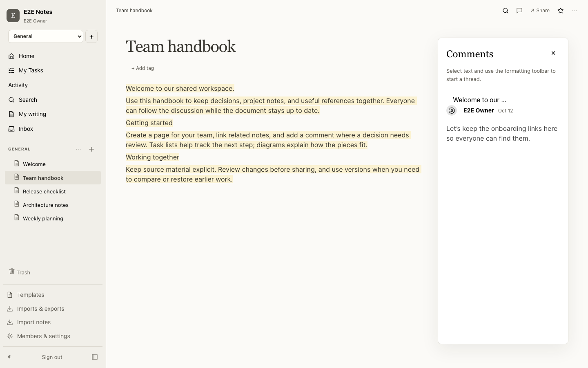

# NoteFlare

A private, self-hosted collaborative wiki built on Cloudflare Workers, Durable Objects, D1, and R2. Write and diagram together, keep knowledge in one workspace, and run the installation in your own Cloudflare account.



## Features

- **Collaboration.** Collaborative documents and diagrams with presence, anchored comments, versions, restore, mentions, backlinks, and scoped FTS5 search.
- **Organization.** Nested/private spaces, tags, templates, task lists with Table/Board views, date mentions and reminders. See the [member guide](docs/USER_GUIDE.md).
- **Writing.** [AI writing](docs/AI_WRITING.md) with explicit sources and private history, enabled by owner settings and credentials. Hosted ChatGPT funding requires separate approval and rollout.
- **Portability.** Markdown, HTML, Word, Notion ZIP import and document/diagram export, including PDF through the optional browser binding.
- **App and sharing.** Installable app shell, public document/table share links, and cached documents. Offline edits, expanded embeds, block links, live diagram embeds, and diff digests have [release controls](docs/FLAGS.md).
- **Integrations.** [Notion-shaped `/v1` API](docs/API_COMPATIBILITY.md) with integration tokens and signed webhooks; member OAuth/MCP and a [ChatGPT plugin](docs/CHATGPT_PLUGIN.md). MCP needs owner enablement; installed-plugin acceptance remains a rollout gate.
- **Slack.** Verified Slack identities, search, access-filtered unfurls, comment mirrors, and thread capture. Rich digest/share features require configured credentials and their [activation gates](docs/FLAGS.md#slack-round-2-activation).

## Why Cloudflare

Each collaborative page epoch has one hibernating Yjs Durable Object. Its SQLite update log and R2 snapshot hold document state; D1 holds metadata, membership, search projections, comments, and typed tables. Workflows handle resumable jobs and Queues handle delivery. This keeps realtime state close to its authoritative room without a separate database server or Redis service.

Documents retain browser IndexedDB copies. Diagrams require a live authoritative connection for edits. Cross-page search and references follow compaction rather than every keystroke. Production hibernation billing and high-concurrency behavior still require deployed load verification.

## Quick start

Requires Node 22.22.2+ in the Node 22 line, 24.15+ in the Node 24 line, or 26+, and pnpm 11.18.0.

```sh
pnpm install
cp .dev.vars.local.example .dev.vars
```

Set a strong `BETTER_AUTH_SECRET` and a private `BOOTSTRAP_TOKEN` in `.dev.vars`, then initialize and start the local app:

```sh
pnpm db:local
pnpm dev
```

Open `http://localhost:5173`, create the owner with that setup credential, then enroll a passkey or authenticator and save recovery codes. See [account security](docs/ACCOUNT_SECURITY.md) and [contributor tooling](CONTRIBUTING.md).

The client supports Chrome/Edge 116+, Firefox 124+, and Safari 17.4+ on macOS/iOS. Startup checks required cancellation APIs and explains when a browser needs upgrading.

## Deploy your own

Workers Paid is the supported production target. As checked on 12 October 2026, its account minimum is **US$5/month**. A small idle installation staying within included allowances may remain near that baseline; this is not a measured or guaranteed total. Storage, compute, requests, optional browser/PDF usage, and AI provider usage can add charges. See [Cloudflare pricing](https://developers.cloudflare.com/workers/platform/pricing/).

The prepared portable browser flow lets Cloudflare provision resources and generate internal secrets from one private setup key. Its native GitHub authorization and editor-flow acceptance gate is still pending, so the deploy button remains disabled; see [verification evidence](docs/evidence/ONE_CLICK_DEPLOYMENT_VERIFICATION.md#remaining-release-gate). New portable defaults enable five editor features; existing named production settings are preserved. The manual installation path remains available.

<!-- Release gate: uncomment this button only after a disposable native-button
deployment and redeployment pass the live checklist in docs/DEPLOYMENT.md.

[](https://deploy.workers.cloudflare.com/?url=https%3A%2F%2Fgithub.com%2Fhbmartin%2Fnoteflare)

-->

Follow the [manual installation steps](docs/DEPLOYMENT.md#existing-production-deployment):

1. Create your D1, R2, Durable Object, Workflow, Queue, and observability resources.
2. Configure the exact HTTPS installation origin and bindings.
3. Set installation secrets; configure Slack, AI, and email only when needed.
4. Build, apply guarded migrations, and deploy.
5. Create the owner, complete account protection, and verify health and core flows.

For an existing installation, read [Upgrading](docs/UPGRADING.md) before deploying. Start at the [documentation index](docs/README.md) for operations and recovery.

## Architecture

```text
Browser
  ├─ React + BlockNote or React Flow + Yjs
  ├─ IndexedDB for documents (workspace:page:epoch:schema)
  ├─ network-authoritative diagram state (no offline mutation queue)
  └─ YPartyKitProvider connections
          ├─ authenticated /parties/document/:page~:epoch
          └─ authenticated /parties/workspace-events/:workspace
Hono Worker
  ├─ Better Auth + D1 metadata/FTS/projections/tables/comments/outbox
  ├─ authorized R2 attachment/version/job-artifact access
  ├─ Cloudflare Workflow jobs + Queue/DLQ deliveries
  ├─ optional Email, Browser Rendering, and Slack integrations
  └─ PartyServer router
          ├────────────────────────────────────┐
Collaborative Page Durable Object (hibernating YServer)
  ├─ 1–5 second merged ~1 MiB SQLite update chunks
  ├─ 30-second R2 current snapshot
  ├─ automatic immutable R2 versions
  └─ delayed structured D1 projection
                                               │
WorkspaceEvents Durable Object (read-only) ────┘
  └─ page and projection invalidation events
```

There is intentionally no ORM, Redis, Postgres, custom WebSocket protocol, Hocuspocus adapter, or repository layer.

### Repository layout

| Directory        | Responsibility                                           |
| ---------------- | -------------------------------------------------------- |
| `src/client/`    | React app, editors, member and owner UI                  |
| `src/worker/`    | HTTP API, authorization, rooms, jobs, deliveries         |
| `src/shared/`    | Shared contracts, document projections, validation       |
| `src/plugin-ui/` | Embedded MCP/ChatGPT editor                              |
| `migrations/`    | Forward D1 schema changes                                |
| `scripts/`       | Build, migration, operational, and verification commands |
| `plugins/`       | Portable plugin manifest, assets, and skills             |
| `tests/`         | Browser integration and acceptance scenarios             |

## Accepted v1 limits

- One private workspace per installation.
- Workers Paid is the supported production target.
- 30 live connections per document epoch.
- Document warning at 16 MiB; server read-only at 24 MiB.
- Diagrams keep their last in-memory view while disconnected but require a completed server sync before edits resume.
- Diagram public-share rendering and diagram import are not included in v1; diagrams export as JSON, SVG, PNG, or PDF.
- 10 MiB single-request file uploads; larger files upload in parts.
- 20,000 table rows, read 500 at a time and sorted by the server.
- Server durability has a crash-only in-memory window of at most the configured five-second save debounce; IndexedDB resynchronizes surviving client edits.
- Search, backlinks, mentions, and previews follow collaborative-page compaction rather than every keystroke.
- A workspace location hint affects only first Durable Object placement and is not a residency guarantee.

## License

AGPL-3.0. See [LICENSE](LICENSE), [security policy](SECURITY.md), and [third-party notices](THIRD_PARTY_NOTICES.md).
