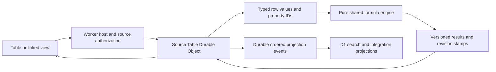

# NoteFlare computed data and relation architecture

Tables use one Durable Object authority per source table. The Worker authorizes the current user and page before sending a short-lived signed command. D1 holds disposable projections for search, tasks and integrations. A linked view stores only source table and saved view IDs; it does not acquire ownership of the source data.

The current implementation adds deterministic formulas and column calculations after the collaborative authority and saved view contracts. Future relations and rollups can extend the dependency and revision formats without changing property identities. Relation storage, cross-table execution and rollup UI are outside this release.

## Identities and versions

Table pages, properties, rows, options and saved views retain their IDs through migration and repair. Property labels are presentation names. Formula compilation resolves labels to property IDs and persists the canonical AST with `astVersion: 1`, inferred result type and dependencies. Renaming a property formats the existing AST with its new label rather than resolving the old source again.

Property configuration uses `version: 1`, independently of property revision and column generation. Formula ASTs, computed values and their source stamps have separate format versions. Unsupported configuration versions are rejected. The formula entry point is [formula/index.ts](../../src/shared/formula/index.ts); both browser previews and Worker authority use it. The evaluation context contains supplied values and property definitions. It has no fetching, networking, authorization, JavaScript evaluation or clock functions.

## Scalar values and explicit errors

Formula values are numbers, strings, booleans, null or a versioned error cell. Dates are ISO strings with an inferred date type. Arrays and arbitrary objects are unsupported inputs and produce type errors. Collection-valued properties remain distinct from scalar properties; a future relation collection must introduce an explicit value and type contract.

Missing properties, dependency failures, cycles, invalid conditions, unsupported AST versions, recursion limits and non-finite results have explicit errors. Changing or deleting a dependency invalidates dependent formulas. Errors propagate through the graph instead of silently becoming zero or an empty string.

Schema changes retype the stored AST in dependency order while retaining its property IDs. Valid result types and readable source labels update together; incompatible changes persist a validation error. Renaming a formula never reparses old property names, so reusing an old name cannot rebind its dependencies. Runtime evaluation checks supplied scalar types and prevents numeric coercion after a property changes to text. Saved views whose calculations or filters become incompatible fall back visibly until repaired.

## Revision stamps and activation

Each computed value has a source stamp with format version, table ID, table revision, schema revision, row ID and row revision. Its dependency entries include table ID, property ID and schema revision. The table authority recomputes rows in dependency order and commits results with the command revision. A property change stages a new schema generation before activation, preventing a partially updated column from becoming authoritative.

The dependency entry shape can later add source row revisions and relation traversal metadata. That extension requires a new version, permission semantics, bounded traversal and invalidation design. This release creates no reverse cross-table indexes, cross-DO subscriptions, join tables or rollup materialization.

D1 computed cells are a projected cache whose source JSON retains the authoritative stamps. Stale results must never overwrite a newer row or schema revision. Calculations operate on the entire authorized filtered set at one table revision before pagination and return typed results plus error counts. UI formatting does not change the stored value.

## Linked views and cards

A linked table block contains `tablePageId` and `viewId`. Reads require access to the host and source; writes require write access to both. Source access is rechecked after reads. Unavailable sources clear previews. Duplication retains the reference; deleting the block leaves source rows intact.

Task lists retain their fixed Task, Assignee, Status and Due date identities. Generic commands may change extra properties and saved views, but reserved task changes require a signed Task service context. Direct and linked task editors use that adapter so detail-page titles, assignment notifications and publication receipts remain consistent. Linked task commands include the host permission check in the authority's commit authorization. Request bodies cannot opt into trusted service context.

Diagram cards keep their node identity, explicit alias, `linkedPageId` and optional `linkedViewId`. A view is valid only for a table source. Preview responses are bounded and authorized independently. Persisted thumbnails use generic cards and explicit aliases so privately resolved content is not shared through image exports.

## Reader and writer rollout

Editor clients advertise schema capabilities, and existing unsupported structures make older clients read-only. New insertion uses `EDITOR_BLOCKS_V2_ENABLED`; disabling insertion keeps existing structures readable and exportable. Portable exports flatten tabs into labelled sections, export status labels as text, and use stable footnote references and anchors. Writable Markdown protects structures until a lossless mapping exists.

Table migration remains explicit and fenced. The mixed deployment supports legacy D1 tables and migrated DO tables concurrently. A DO outage never reopens D1 writes. Lease retirement follows the release closeout in [Phase 7](../roadmap/07-collaborative-tables.md), and saved views follow [Phase 8](../roadmap/08-table-views-properties.md).
